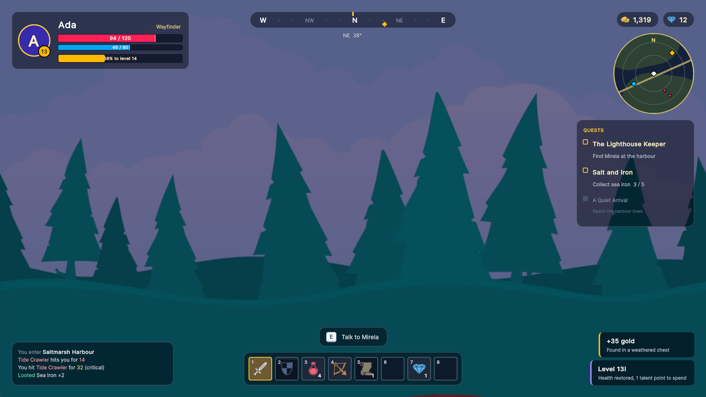
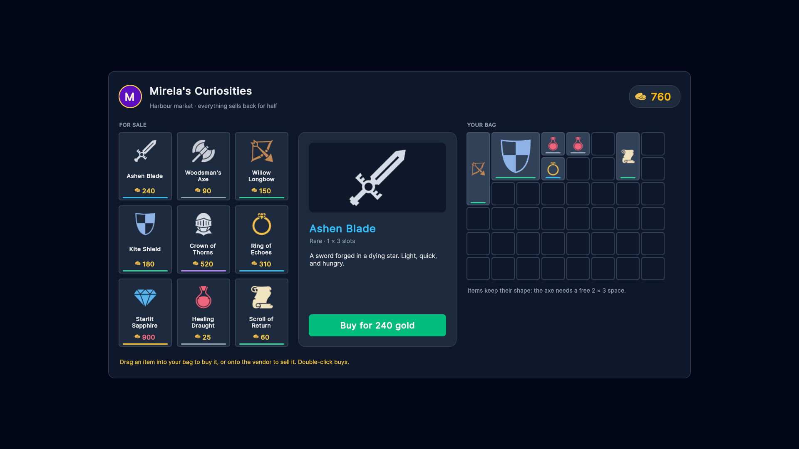

# Weave UI

**Weave UI** is a toolkit package for Unity 6 runtime.

- Tailwind utility classes on design tokens.
- A themed controls library, plus 9 slice art skins that restyle the same markup.
- Screens bound to view models, with transitions and modals.
- A virtualised inventory grid with drag and drop.
- A fluent C# builder, and an interaction system that hands each handler exactly the values it asks for.

## Installing

Coming soon, awaiting Unity approval.

## Samples

| | Sample | Shows |
|---|---|---|
| [](Samples/GameHud) | **[Game HUD](Samples/GameHud)** | Utility-class layout, bars driven by bound percentages, a recoloured hotbar grid, toasts built in C#, a pointer-transparent overlay |
| [](Samples/SettingsMenu) | **[Settings menu](Samples/SettingsMenu)** | Tabs, two-way binding for every control, Apply/Revert with dirty tracking, key rebinding, live light/dark switching, a modal |
| [](Samples/ShopInventory) | **[Shop + inventory](Samples/ShopInventory)** | A vendor grid and a multi-slot bag, drag to buy and sell with custom drop rules, injected handler arguments, a confirmation modal |
| [](Samples/BuilderThemes) | **[Builder + themes](Samples/BuilderThemes)** | A screen written only in C#, then restyled five ways: dark, light, a palette of variable overrides, and art skins from Kenney and from Synty art you own |

## How a Weave screen fits together

```csharp
[ScreenLayout("WeaveUISamples/SettingsMenu/Settings")]        
// UXML under a Resources folder
public sealed class SettingsScreen : Screen<SettingsViewModel>  
// The view model is the root's data source
{
    public SettingsScreen(SettingsViewModel viewModel) : base(viewModel) { }

    // Settings.uxml has <weave:Button click="AskDefaults" />; an [OnClick("defaults")] attribute works too.
    [Preserve]
    void AskDefaults() => Manager.Push(new ConfirmDialog(...));
}
```

```xml
<ui:VisualElement class="flex-row items-center gap-3 p-4 rounded-xl bg-slate-900 hover:bg-slate-800">
    <weave:Slider low-value="0" high-value="100">
        <Bindings>
            <ui:DataBinding property="value" data-source-path="Master" binding-mode="TwoWay" />
        </Bindings>
    </weave:Slider>
</ui:VisualElement>
```

- **Layout and style:** Tailwind utility classes in the markup (`hover:`, `focus:`, `active:`,
  `disabled:` and `dark:` variants included), plus a small USS file per screen for the rest. Controls take their
  colours from semantic variables (`--weave-primary`, `--weave-surface`, ...), so one palette file restyles
  everything.
- **Data:** view models derive from `ViewModel` and mark bindable properties with `[CreateProperty]`. UI Toolkit's
  runtime binding does the rest.
- **Input:** handlers are attributes (`[OnClick]`, `[OnCellClick]`, `[OnDrop]`, ...) or method names in UXML
  (`click="Apply"`, `change="QualityChanged"`). They declare the values they want: the item, the slot, the drag, the
  previous value, modifier keys. Weave injects them.
- **Hosting:** one `ScreenHost` component creates the UI document. It owns the screen stack (push, pop, modals,
  transitions) and `ThemeService` (light/dark, palette, skin).

## Requirements

- Unity 6000.3 or newer.
- The Weave UI package (`Soon`)

The screenshots were captured in Unity 6000.4 at 1920 × 1080.

## Credits

All art in these samples is pre-made by the artists below; none of it is AI-generated.

### Item icons: game-icons.net

Used in **Game HUD** (hotbar, currencies) and **Shop + inventory** (vendor, bag, gold counter), from
`Resources/WeaveUISamples/<Sample>/Icons/`.

| Used for | Icon | Author |
|---|---|---|
| Sword (Ashen Blade) | [broadsword](https://game-icons.net/1x1/lorc/broadsword.html) | Lorc |
| Axe (Woodsman's Axe) | [battle-axe](https://game-icons.net/1x1/lorc/battle-axe.html) | Lorc |
| Bow (Willow Longbow) | [pocket-bow](https://game-icons.net/1x1/lorc/pocket-bow.html) | Lorc |
| Shield (Kite Shield) | [checked-shield](https://game-icons.net/1x1/lorc/checked-shield.html) | Lorc |
| Helmet (Crown of Thorns) | [visored-helm](https://game-icons.net/1x1/lorc/visored-helm.html) | Lorc |
| Potion (Healing Draught) | [round-bottom-flask](https://game-icons.net/1x1/lorc/round-bottom-flask.html) | Lorc |
| Gem (Starlit Sapphire) | [cut-diamond](https://game-icons.net/1x1/lorc/cut-diamond.html) | Lorc |
| Scroll (Scroll of Return) | [scroll-unfurled](https://game-icons.net/1x1/lorc/scroll-unfurled.html) | Lorc |
| Gold coins | [two-coins](https://game-icons.net/1x1/delapouite/two-coins.html) | Delapouite |
| Ring (Ring of Echoes) | [diamond-ring](https://game-icons.net/1x1/delapouite/diamond-ring.html) | Delapouite |

- **Source:** [game-icons.net](https://game-icons.net)
- **Licence:** [CC BY 3.0](https://creativecommons.org/licenses/by/3.0/)
- **Changes:** each icon was recoloured from white to one solid colour and resized to 128 × 128 px with a small margin.

### Kenney

Kenney's packs are [CC0](https://creativecommons.org/publicdomain/zero/1.0/) (public domain): no credit is required,
but it's given here with thanks.

| Pack | Used in | Changes |
|---|---|---|
| [Background Elements Remastered](https://kenney.nl/assets/background-elements-remastered) (`backgroundColorForest.png`) | **Game HUD**: the scene behind the HUD, `Resources/WeaveUISamples/GameHud/Backdrop.png` | None to the file; the sample tints it darker at runtime |
| [UI Pack (RPG Expansion)](https://kenney.nl/assets/ui-pack-rpg-expansion) | **Builder + themes**: the *Kenney* skin, which comes from Weave UI's Basic Menu sample | Hover and focus states lightened, the bar pieces joined into one sprite, the checkbox tick placed on its box |

By [Kenney](https://kenney.nl) (Kenney Vleugels).

### Synty Studios (not included)

The *Synty* skin in the **Builder + themes** screenshots is built from
[INTERFACE - Fantasy Menus](https://syntystore.com/products/interface-fantasy-menus) by
[Synty Studios](https://syntystore.com). Synty's licence doesn't allow redistributing the art, so this repository
contains only the editor script that builds the skin from your own copy. You need your own licence to use it.
