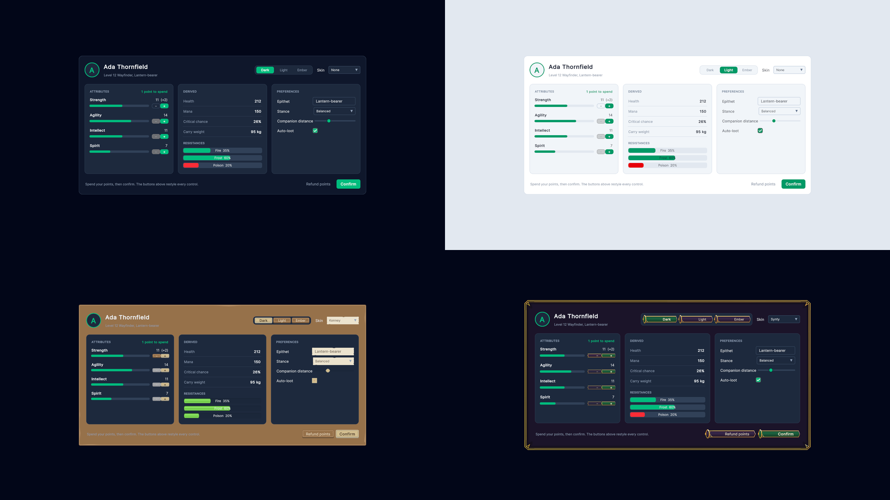
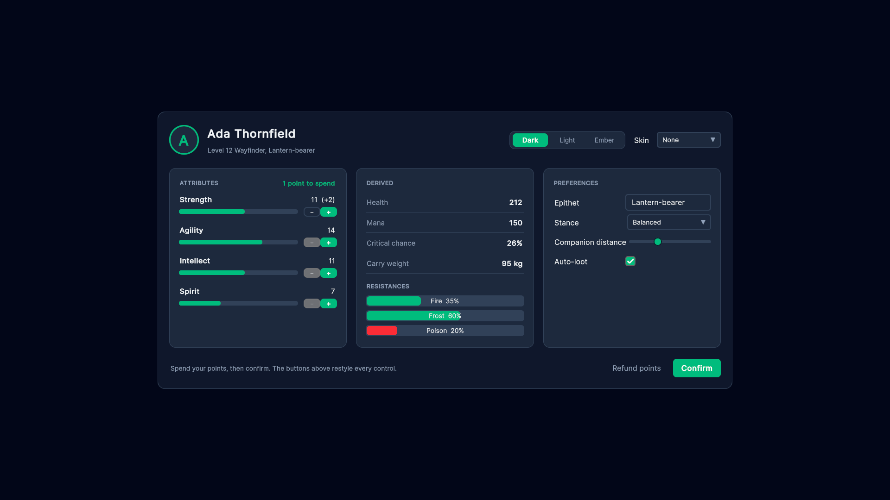
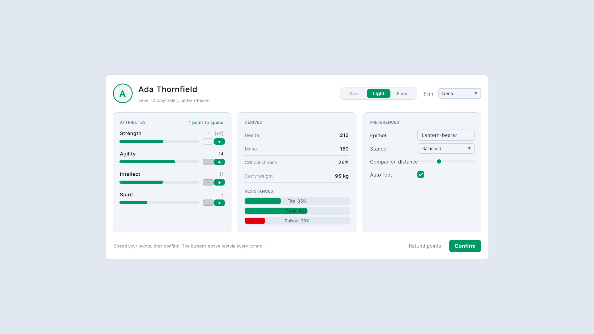
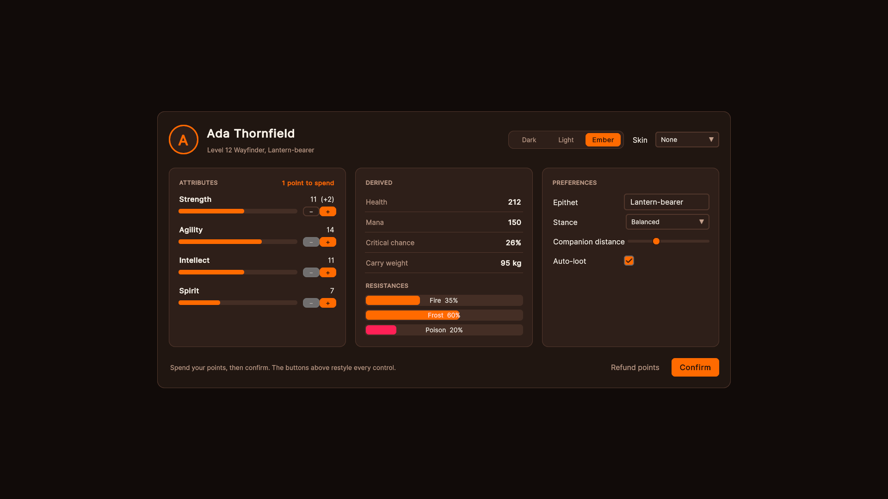
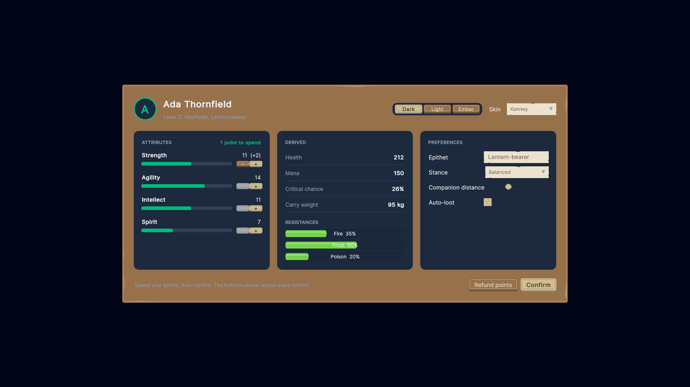
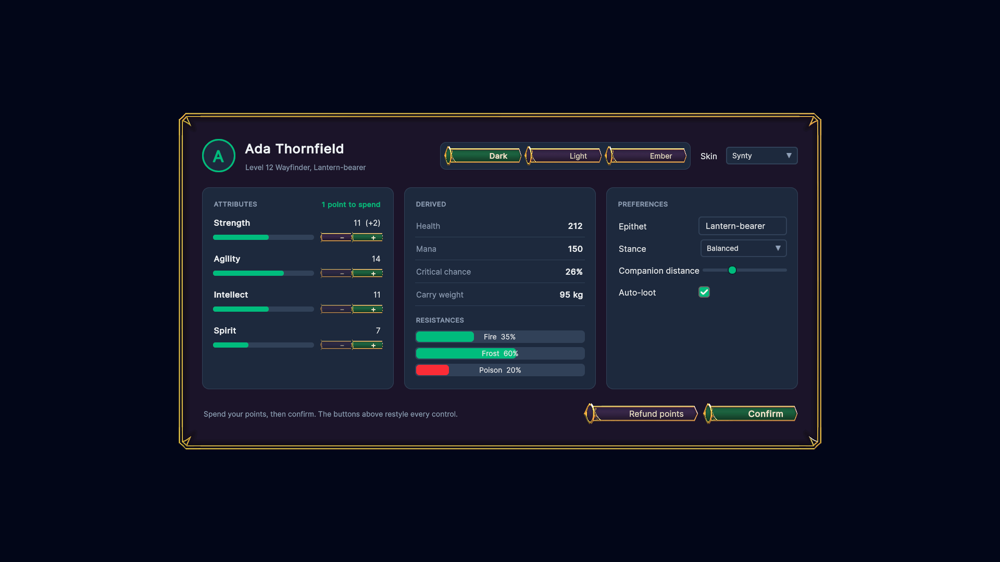

# Builder + themes

A character sheet written entirely in C# with the fluent builder (no UXML), shown in five looks: dark, light, a custom
"Ember" palette, and two art skins, one from Kenney's free UI art and one from Synty's INTERFACE - Fantasy Menus. The
markup and code are the same in all five.

## What it shows

- **The fluent builder.** [`CharacterSheetScreen`](Scripts/CharacterSheetScreen.cs) overrides `CreateRoot()` and
  builds everything with `Row()`, `Column()`, `Text()`, `Button()`, `Slider()`, ... Classes, variants, sizes,
  tooltips, bindings and click handlers read the same as in UXML:

  ```csharp
  Button("+").Size("sm").Variant("primary")
      .Bind(nameof(Stat.CanIncrease))            // a Button's main property is enabledSelf
      .OnClick(() => ViewModel.Increase(stat))
  ```

- **Per-row data sources.** Each attribute row sets `.DataSource(stat)`, so its bindings name `Stat` properties
  while the rest of the sheet binds to the character.
- **Theming through variables.** [`CharacterSheet.uss`](Resources/WeaveUISamples/BuilderThemes/CharacterSheet.uss)
  only uses Weave's semantic variables (`--weave-surface`, `--weave-text`, `--weave-primary`, ...). Then:
  - **Light** is `ThemeService.Mode = ThemeMode.Light`.
  - **Ember** is one stylesheet of variable overrides,
    [`EmberPalette.uss`](Resources/WeaveUISamples/BuilderThemes/EmberPalette.uss), set as `ThemeService.Palette`.
  - **Skin** is `ThemeService.Skin`, a `UISkin` asset of 9-slice sprites per control and state. It replaces the
    controls' art; the screen's code doesn't change. The *Skin* dropdown lists every skin the sample finds.
- **A skin from art you own.** [`SyntySkinBuilder`](Editor/SyntySkinBuilder.cs) turns Synty's INTERFACE - Fantasy
  Menus sprites into a `UISkin`. Synty draws a button as a tinted fill plus a frame, and USS has one background
  image per element, so the builder flattens each state into one sprite and keeps Synty's 9-slice borders. The same
  approach works for any art pack: find the sprites, set their slices, and list them per control and state.
- **Tuning a skin for one screen.** Synty's buttons are wide menu buttons, so `CharacterSheet.uss` draws them at a
  smaller slice scale on the small +/- buttons, in rules scoped to `.skin-synty-fantasy`.
- **Variants at runtime.** The theme switcher's buttons swap between `primary` and `ghost` with `.Variant(...)`.

## Files

| File | Role |
|---|---|
| [`Scripts/CharacterSheetScreen.cs`](Scripts/CharacterSheetScreen.cs) | The whole layout, in C# |
| [`Scripts/CharacterViewModel.cs`](Scripts/CharacterViewModel.cs) | Attributes, points, derived stats, preferences, theme choice |
| [`Scripts/BuilderThemesSample.cs`](Scripts/BuilderThemesSample.cs) | Bootstrap: finds the skins, applies mode, palette and skin through `ThemeService` |
| [`Editor/SyntySkinBuilder.cs`](Editor/SyntySkinBuilder.cs) | Builds the Synty skin from your copy of the pack |
| [`Resources/.../CharacterSheet.uss`](Resources/WeaveUISamples/BuilderThemes/CharacterSheet.uss) | Sheet styles, semantic variables only |
| [`Resources/.../EmberPalette.uss`](Resources/WeaveUISamples/BuilderThemes/EmberPalette.uss) | The Ember palette: variable overrides only |

## Run it

Imported from the Package Manager, open `BuilderThemes.unity` and press Play. Anywhere else, add **Builder Themes
Sample** to an empty GameObject and press Play. Dark, light and Ember work straight away. For the skins:

- **Kenney:** import Weave UI's Basic Menu sample too. Its skin is built from Kenney's
  [UI Pack (RPG Expansion)](https://kenney.nl/assets/ui-pack-rpg-expansion) and is picked up automatically.
- **Synty:** Synty's art can't be redistributed, so this sample doesn't include it. Import
  [INTERFACE - Fantasy Menus](https://syntystore.com/products/interface-fantasy-menus) from the Synty Store into your
  project, then run **Tools > Weave UI Samples > Build Synty Fantasy Menus Skin**. The skin is written next to the
  pack, under `WeaveSkin/Resources`, and appears in the dropdown the next time you press Play.

You can also assign any `UISkin` to the component's *Kenney Skin* or *Synty Skin* field. Skins the sample can't find
are left out of the dropdown.

## Art

The Kenney skin uses [Kenney](https://kenney.nl)'s UI Pack (RPG Expansion), CC0. The Synty skin is
built from Synty Studios' INTERFACE - Fantasy Menus, which you need your own licence for.

## Screenshots







