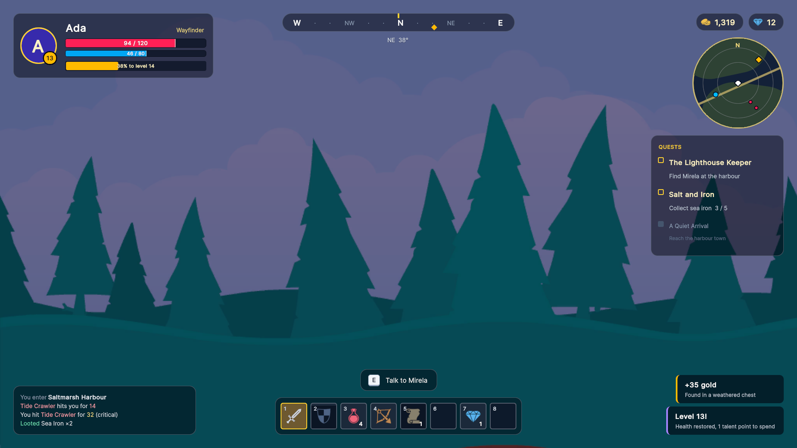

# Game HUD

An in-game overlay: a player frame, a compass, currencies, a minimap, a quest tracker, a combat log, toasts and a
hotbar. It shows how far utility classes and data binding go before you need any code.

## What it shows

- **Layout from utility classes.** `absolute top-8 left-8`, `flex-row items-center gap-3` and Tailwind colours do
  the positioning and spacing in [`Hud.uxml`](Resources/WeaveUISamples/GameHud/Hud.uxml). Hud.uss only holds what
  utilities can't express.
- **Bars driven by binding.** The health fill binds `style.width` to a `StyleLength` percentage on the view model. A
  second white bar binds to the same value, but its USS transition waits 0.35 s before it catches up, so every hit
  shows how much health it took. No animation code.
- **A recoloured `weave:Grid`.** The hotbar is Weave's inventory grid. `.hotbar` overrides Weave's semantic
  variables (`--weave-surface`, `--weave-primary`, ...) instead of restyling cells one by one. Slots can be dragged
  to rearrange them, and a click uses a slot through `[OnCellClick("hotbar")]`.
- **Per-slot data in a cell template.** [`HotbarSlot.uxml`](Resources/WeaveUISamples/GameHud/HotbarSlot.uxml) binds
  the icon, the stack count and a cooldown overlay whose height is a bound percentage. `BindCell` adds the key
  number to empty slots too.
- **UXML and C# together.** Quests, log lines and toasts are built with the fluent builder (`Row()`, `Text()`,
  `.Class(...)`) using the same utility classes as the markup. Toasts slide in and out with a USS transition.
- **Pointer-transparent overlay.** Everything except the hotbar is `picking-mode="Ignore"`, so clicks reach the game
  underneath.

## Files

| File | Role |
|---|---|
| [`Scripts/HudScreen.cs`](Scripts/HudScreen.cs) | The screen: hotbar setup, quest/log rows, toasts, the click handler |
| [`Scripts/HudViewModel.cs`](Scripts/HudViewModel.cs) | Health, mana, XP, gold, quests, log; `TakeDamage`, `GainXp`, `Use(slot)` |
| [`Scripts/HotbarSlot.cs`](Scripts/HotbarSlot.cs) | One slot: icon, count, cooldown |
| [`Scripts/GameHudSample.cs`](Scripts/GameHudSample.cs) | Bootstrap: pushes the HUD and fakes a little gameplay |
| [`Scripts/DemoBackdrop.cs`](Scripts/DemoBackdrop.cs) | Puts the forest backdrop behind the HUD (stands in for your game's camera) |
| [`Resources/.../Hud.uxml`](Resources/WeaveUISamples/GameHud/Hud.uxml) | Layout and bindings |
| [`Resources/.../Hud.uss`](Resources/WeaveUISamples/GameHud/Hud.uss) | Cards, bars, minimap, compass, hotbar colours, toasts |
| [`Resources/.../HotbarSlot.uxml`](Resources/WeaveUISamples/GameHud/HotbarSlot.uxml) | Hotbar cell template |

## The idea in 10 lines

```csharp
[CreateProperty]
public StyleLength HealthFill => Length.Percent(100 * _health / MaxHealth);

public void TakeDamage(float amount) => Health -= amount;   // the bars, text and lag bar follow
```

```xml
<ui:VisualElement class="bar__fill">
    <Bindings>
        <ui:DataBinding property="style.width" data-source-path="HealthFill" binding-mode="ToTarget" />
    </Bindings>
</ui:VisualElement>
```

```css
.bar__lag { transition: width 0.8s ease-out-cubic 0.35s; }   /* waits, then catches up */
```

## Run it

Imported from the Package Manager, open `GameHud.unity` and press Play. Anywhere else, add **Game HUD Sample** to an
empty GameObject (it brings `ScreenHost` and `UIDocument` with it) and press Play. Click a hotbar slot to use it, or
drag slots to rearrange them.

## Art

The item icons are from [Kenney](https://kenney.nl)'s [1-Bit Pack](https://kenney.nl/assets/1-bit-pack) (CC0), enlarged 4x. The backdrop is [Kenney](https://kenney.nl)'s Background Elements Remastered (forest), CC0, standing in for your game's camera.

## Screenshots


