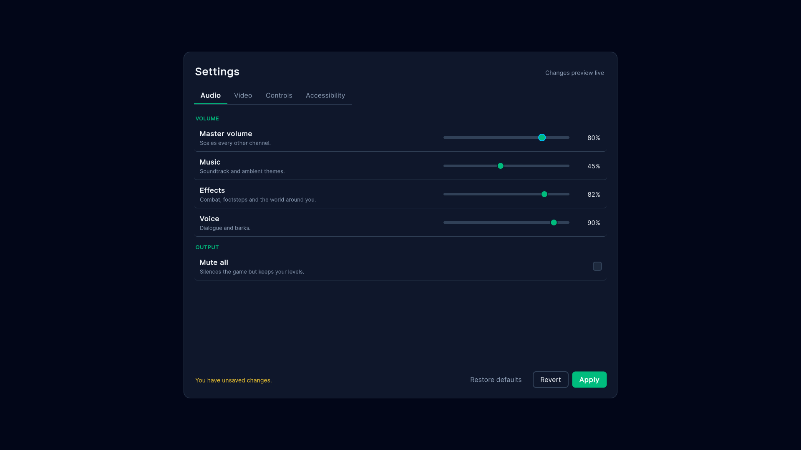
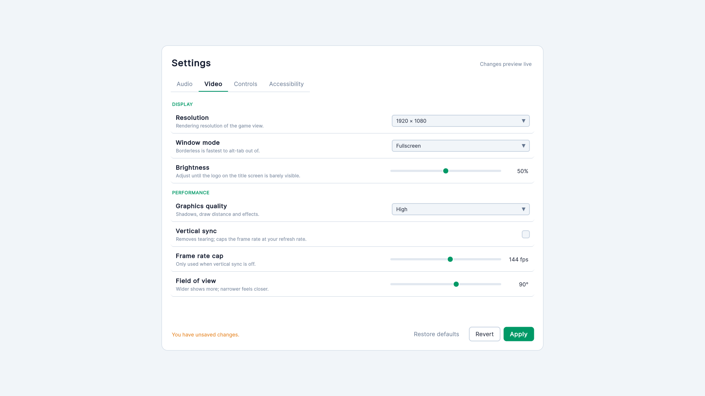
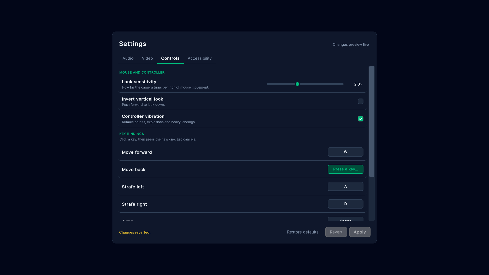
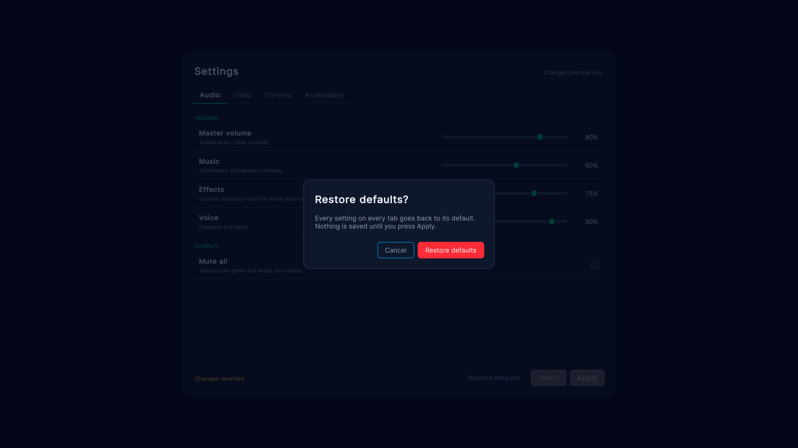

# Settings menu

A full options menu: four tabs of audio, video, controls and accessibility settings, with live preview, Apply and
Revert, rebindable keys, and a "restore defaults" confirmation.

## What it shows

- **Two-way binding for every control.** Each slider, toggle and dropdown in
  [`Settings.uxml`](Resources/WeaveUISamples/SettingsMenu/Settings.uxml) binds `value` (or `index`) to a property
  on [`SettingsViewModel`](Scripts/SettingsViewModel.cs). The screen class has no code for reading or writing them.
- **Dirty tracking with no extra wiring.** Edits go into a working copy. `HasChanges` compares it with the applied
  copy, and Apply and Revert bind `enabledSelf` to it. Rows bind `enabledSelf` too: the volume sliders grey out while
  muted, and the frame cap greys out while vertical sync is on.
- **Handlers by name, on the view model.** `click="Apply"`, `click="Revert"` and `change="QualityChanged"` resolve to
  view-model methods first, then the screen. `QualityChanged(string quality, [Previous] string was)` gets the old
  value injected.
- **Theme follows semantic variables.** [`Settings.uss`](Resources/WeaveUISamples/SettingsMenu/Settings.uss) only
  uses `var(--weave-text)`, `var(--weave-border)` and the like, so the Light theme toggle restyles the whole menu
  live with no `dark:` classes.
- **Key rebinding in C#.** The binding rows are built with the fluent builder. Clicking a key listens for the next
  key press. Escape cancels via `OnBack()` instead of leaving the screen.
- **A modal dialog.** `ConfirmDialog` is a `ModalScreen`: backdrop, focus trap, Escape and backdrop-click to close,
  using Weave's built-in `modal__*` styles.

## Files

| File | Role |
|---|---|
| [`Scripts/SettingsScreen.cs`](Scripts/SettingsScreen.cs) | The screen: key-binding rows, rebinding, Restore defaults |
| [`Scripts/SettingsViewModel.cs`](Scripts/SettingsViewModel.cs) | Every setting, `HasChanges`, Apply/Revert (saved with `PlayerPrefs`) |
| [`Scripts/KeyBinding.cs`](Scripts/KeyBinding.cs) | One rebindable action |
| [`Scripts/ConfirmDialog.cs`](Scripts/ConfirmDialog.cs) | Reusable yes/no modal |
| [`Scripts/SettingsMenuSample.cs`](Scripts/SettingsMenuSample.cs) | Bootstrap: applies Light theme and Reduce motion to the UI |
| [`Resources/.../Settings.uxml`](Resources/WeaveUISamples/SettingsMenu/Settings.uxml) | Tabs, rows and bindings |
| [`Resources/.../Settings.uss`](Resources/WeaveUISamples/SettingsMenu/Settings.uss) | Setting rows, section headings, keycaps |
| [`Resources/.../Confirm.uxml`](Resources/WeaveUISamples/SettingsMenu/Confirm.uxml) | The dialog layout |

## The idea in 10 lines

```xml
<weave:Slider name="master" low-value="0" high-value="100">
    <Bindings>
        <ui:DataBinding property="value" data-source-path="Master" binding-mode="TwoWay" />
    </Bindings>
</weave:Slider>
<weave:Button text="Apply" variant="primary" click="Apply">
    <Bindings>
        <ui:DataBinding property="enabledSelf" data-source-path="HasChanges" binding-mode="ToTarget" />
    </Bindings>
</weave:Button>
```

## Run it

Imported from the Package Manager, open `SettingsMenu.unity` and press Play. Anywhere else, add **Settings Menu
Sample** to an empty GameObject and press Play. Settings are saved to `PlayerPrefs` when you press Apply.

## Screenshots





