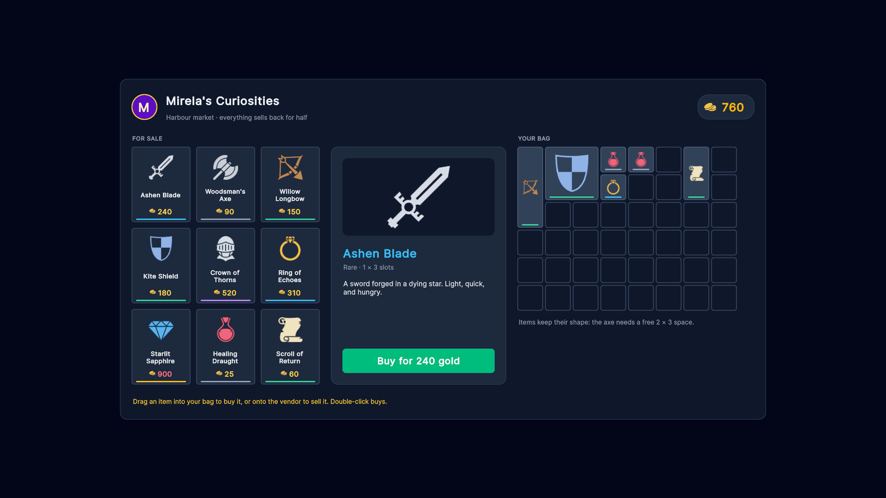
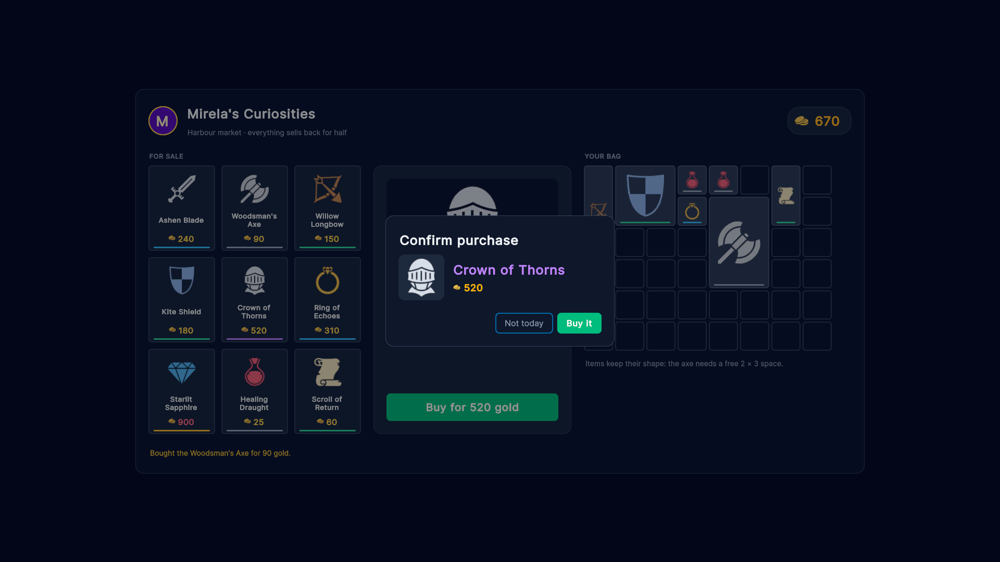

# Shop + inventory

A vendor screen: a grid of items for sale, a details panel, and a bag where every item takes its real shape. Drag to
buy and sell, double-click to buy, and confirm expensive purchases in a modal.

## What it shows

- **Two kinds of `weave:Grid`.** The vendor is a plain grid bound to a list (one item per slot) with a card
  template. The bag is an occupancy grid over an `OccupancyMap`, so a sword takes 1 × 3 slots and a shield 2 × 2.
- **Drag and drop as game rules.** Both grids use `drag="manual"`: Weave still validates every drop (does it fit,
  `DropRule` says whether you can afford it) and highlights the target slots green or red, but the handlers decide
  what a drop means:

  ```csharp
  [OnDrop("bag")]
  void DroppedInBag(GridDrag drag, [Slot] int slot)      // vendor → bag buys a copy, bag → bag moves

  [OnDrop("vendor")]
  void DroppedOnVendor([Source] Item item) => ViewModel.Sell(item);
  ```

- **Injected handler arguments.** `[OnCellClick("vendor")] void SelectStock(Item item)` gets the clicked item;
  `Clicks = 2` makes a double-click handler; `[OnDragCancel]` explains why a drop was refused.
- **Bindings that change colour.** Prices bind `style.color` to `PriceColor`, which turns red when you can't afford
  the item. The details panel binds the item name's colour to its rarity.
- **A modal with its own data source.** `ConfirmPurchase` is a `ModalScreen<Item>`, so its UXML binds to the item
  like any other screen.

## Files

| File | Role |
|---|---|
| [`Scripts/ShopScreen.cs`](Scripts/ShopScreen.cs) | Grid setup, drop rules, click/drop handlers, purchase confirmation |
| [`Scripts/ShopViewModel.cs`](Scripts/ShopViewModel.cs) | Stock, bag (`OccupancyMap`), gold, selection; `Buy`, `Sell`, `Move` |
| [`Scripts/Item.cs`](Scripts/Item.cs) | One item: icon, rarity, price, size |
| [`Scripts/ConfirmPurchase.cs`](Scripts/ConfirmPurchase.cs) | The "are you sure?" modal |
| [`Scripts/ShopInventorySample.cs`](Scripts/ShopInventorySample.cs) | Bootstrap |
| [`Resources/.../Shop.uxml`](Resources/WeaveUISamples/ShopInventory/Shop.uxml) | Layout and bindings |
| [`Resources/.../StockCard.uxml`](Resources/WeaveUISamples/ShopInventory/StockCard.uxml) | Vendor cell template |
| [`Resources/.../BagItem.uxml`](Resources/WeaveUISamples/ShopInventory/BagItem.uxml) | Bag piece template |
| [`Resources/.../ConfirmPurchase.uxml`](Resources/WeaveUISamples/ShopInventory/ConfirmPurchase.uxml) | The dialog layout |
| [`Resources/.../Shop.uss`](Resources/WeaveUISamples/ShopInventory/Shop.uss) | Cards, details panel, gold counter |

## Run it

Imported from the Package Manager, open `ShopInventory.unity` and press Play. Anywhere else, add **Shop Inventory
Sample** to an empty GameObject and press Play. Drag an item from the vendor into a free space in your bag to buy it;
drag it back onto the vendor to sell it for half.

## Art

The item icons are from [Kenney](https://kenney.nl)'s [1-Bit Pack](https://kenney.nl/assets/1-bit-pack) (CC0), enlarged 4x.

## Screenshots



